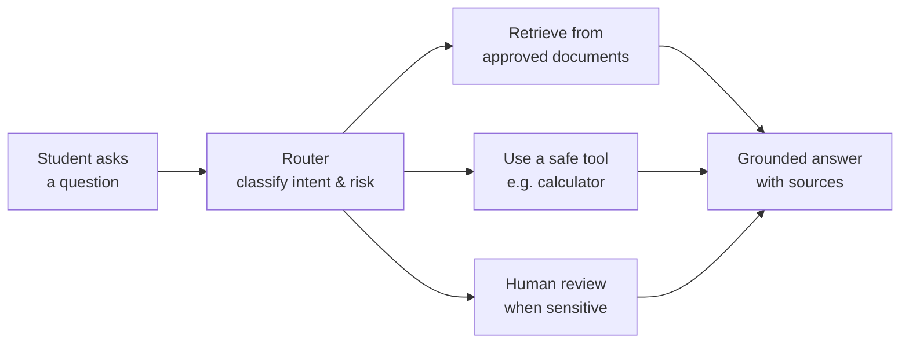
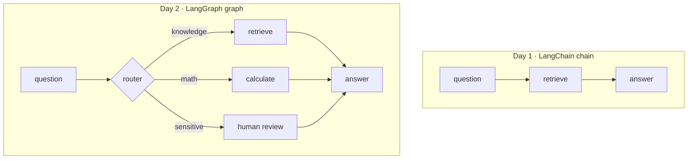

# IUIU Seminar — Building Generative AI Applications

Starter code for the two-day practical seminar at the **Islamic University in Uganda (IUIU)**.
Facilitator: **Lutaaya Huzaifah Idris**.

## What we're building

By the end of the two days, each team has a working **AI University Knowledge Assistant** —
a small chat app that answers student questions **using only approved university documents**,
and behaves responsibly:

| Behaviour | Example |
|---|---|
| **Answers with a source** | *"The library is open Mon–Fri, 8am–10pm (source: iuiu_student_faq.md)"* |
| **Admits when it doesn't know** | *"I could not find this in the approved documents."* — instead of guessing |
| **Uses a tool** | A math question goes to a calculator, not the handbook |
| **Asks a human** | A sensitive question (a grade dispute, a complaint) **pauses for human review** |

We build this **one project twice**, so the difference between the two frameworks is obvious:

- **Day 1 — LangChain:** the assistant as a **straight line** (a chain). Every question
  takes the same path: `retrieve → answer`.
- **Day 2 — LangGraph:** the *same* assistant rebuilt as a **graph** that can decide, use a
  tool, and pause for human review.

### What each team demos at the end

Three questions that prove all the behaviours above:

1. **Supported** — `What are the library hours?` → grounded answer **with source**
2. **Unsupported** — `Who won the 2010 World Cup?` → *"not in the approved documents"*
3. **Needs a human** — `I think my grade is wrong, what do I do?` → **routed to human review**

---

## The big picture



Day 1 builds the **Retrieve → Answer** part as one straight line.
Day 2 adds the **Router** and the **Human review** branches — that is the graph.

---

## Setup (once)

```bash
# 1. Install the dependencies
uv sync

# 2. Create your .env from the template and paste your OpenRouter key
cp .env.example .env        # then edit .env

# 3. Check it works
python day_1/01_chat.py
```

Get a free OpenRouter key at <https://openrouter.ai/keys>. The default model is free
(`nvidia/nemotron-3.5-lightning:free`). **Never commit your real `.env`.**

> **Optional stretch (vector database):** the core workshop uses zero-setup keyword
> search (BM25). To try a real local vector database on Day 2, run
> `uv sync --extra vectordb` — this adds Chroma + a small embedding model and enables
> `day_2/03_vector_db_optional.py` and the vector-DB switch in `app.py`.

---

## What's inside

```
day_1/   LangChain  — a straight line
  01_chat.py                talk to a model
  02_prompts.py             prompt templates + typed output
  03_rag_hint.py            retrieval: answer from documents, with sources
  04_agent_tools.py         tools: let the model use a calculator / weather
  05_assistant_langchain.py the Day 1 capstone assistant (one straight path)

day_2/   LangGraph  — a graph that decides
  01_langgraph_basics.py    state, nodes, edges (the shape)
  02_knowledge_assistant.py the SAME assistant, now with routing + human review
  app.py                    a Streamlit chat page (switch BM25 / vector DB)
  03_vector_db_optional.py  OPTIONAL: a real local vector DB (Chroma)

data/    small, approved SAMPLE documents (fictional — safe to share)
docs/    diagrams for the sessions
```

See **[day_1/README.md](day_1/README.md)** and **[day_2/README.md](day_2/README.md)**
for the diagrams and a step-by-step walk-through.

---

## Chain vs Graph — the one idea to remember



A **chain** does the same steps every time. A **graph** can look at the question and
choose a different path — including stopping to ask a human.
