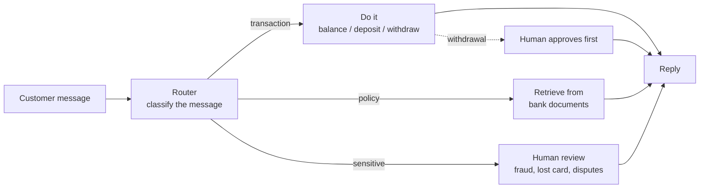

# Sandbox Bank Assistant — GenAI Seminar (Banking Track)

A second, banking-themed version of the seminar. Same topics as the main track,
taught through one fun project: an **AI bank assistant**.

> *Sandbox Bank* is fictional — there is no real money anywhere. The account
> details live in a plain JSON file (`data/account.json`), our **"database without
> a database"**: open it and watch the balance change as you deposit and withdraw.
> To start fresh, set the balance back to `100.0` (or run `git checkout banking/data/account.json`).

## What we're building

By the end of the two days you have a bank assistant that:

| Behaviour | Example |
|---|---|
| **Does transactions** | *"Deposit 50"*, *"What's my balance?"*, *"Withdraw 40"* |
| **Asks a human first** | A **withdrawal** pauses for human approval before money leaves |
| **Answers from policy docs** | *"What is the daily withdrawal limit?"* → grounded answer **with source** |
| **Escalates risky cases** | *"I lost my card"* → routed to a **human** |

We build it **twice**, so the difference between the frameworks is obvious:

- **Day 1 — LangChain:** the assistant as a **straight line** (a chain). It can
  *answer* policy questions, but it can't decide or act.
- **Day 2 — LangGraph:** the same idea rebuilt as a **graph** that **routes**,
  does **transactions**, and **pauses for a human**.

### The demo (end of Day 2)

Four messages, four behaviours:

1. **Transaction** — `Withdraw 40` → `[APPROVAL NEEDED]` → human says yes → done
2. **Policy** — `What is the daily withdrawal limit?` → grounded answer **with source**
3. **Sensitive** — `I lost my card` → **routed to a human**
4. **Balance** — `What's my balance?` → read straight from the account

---

## The big picture



Day 1 builds the **policy → answer** part as a straight line.
Day 2 adds the **router**, the **transactions**, and the **human approval**.

---

## Setup (once)

The banking track shares the repo's dependencies and `.env`:

```bash
uv sync                     # from the repo root
cp .env.example .env        # then paste your OpenRouter key
python banking/day_1/01_chat.py
```

Get a free key at <https://openrouter.ai/keys>. The default model is free
(`nvidia/nemotron-3.5-lightning:free`).

---

## What's inside

```
banking/
  day_1/   LangChain — a straight line
    01_chat.py                talk to a model
    02_prompts.py             prompt templates + structured output ({action, amount})
    03_rag_policies.py        answer policy questions from docs, with sources
    04_tools.py               tools: let the model check balance / deposit / withdraw
    05_assistant_langchain.py the Day 1 capstone (one straight path)

  day_2/   LangGraph — a graph that decides
    01_langgraph_basics.py    state, nodes, edges (the shape)
    02_banking_assistant.py   the SAME assistant, now routing + human approval
    app.py                    a Streamlit chat with Approve / Decline buttons
    03_vector_db_optional.py  OPTIONAL: a real local vector DB (Chroma)

  data/    account.json  the customer's details + balance (our no-DB "database")
           *.md          the bank's FAQ + policies (fictional — safe to share)
```

See **[day_1/README.md](day_1/README.md)** and **[day_2/README.md](day_2/README.md)**
for the step-by-step walk-through and diagrams.
