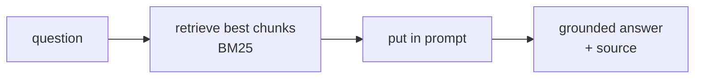
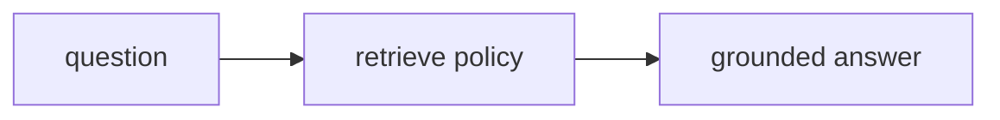

# Banking · Day 1 — LangChain foundations

Day 1 builds the pieces as a **straight line**. Run the steps in order:

```bash
python banking/day_1/01_chat.py            # talk to a model
python banking/day_1/02_prompts.py         # templates + structured output
python banking/day_1/03_rag_policies.py    # answer from the bank's docs (BM25)
python banking/day_1/04_tools.py           # tools: balance / deposit / withdraw
python banking/day_1/05_assistant_langchain.py   # capstone: the straight line
```

Each script accepts your own typed input; press **Enter** to use the example hint.

---

## Step 1 — Talk to a model (`01_chat.py`)
Send one message, get a reply. `model.invoke(question)` is the heart of everything.

## Step 2 — Prompts & structured output (`02_prompts.py`)
- A **prompt template** = a fixed role + a `{blank}` you fill in.
- **Structured output** turns *"deposit fifty thousand shillings"* into tidy fields:
  `{action: "deposit", amount: 50000}` — data your code can use. (A `Literal` locks
  `action` to `balance / deposit / withdraw`.)

## Step 3 — RAG over the bank's policies (`03_rag_policies.py`)
Answer questions from `data/*.md` and **cite the source**. Keyword search (BM25),
no embeddings, no downloads.



## Step 4 — Tools & a simple agent (`04_tools.py`)
Give the model three **tools** — `check_balance`, `deposit`, `withdraw` — and it
decides which to call. (No human approval yet — that's Day 2.)

## Step 5 — Capstone, the straight line (`05_assistant_langchain.py`)
The Day 1 assistant: **every** question takes the same path.



It can **answer** policy questions, but it can't **decide** or **act**. That limit
is exactly what Day 2 fixes with a graph.
