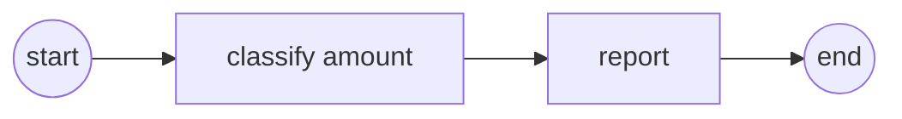
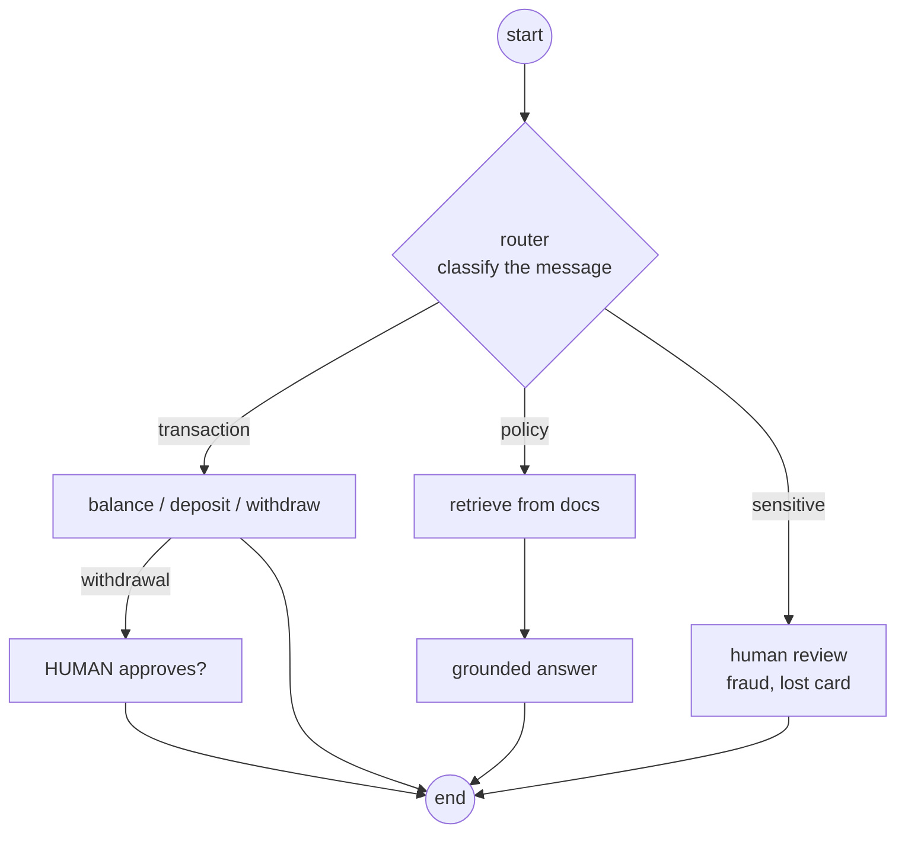
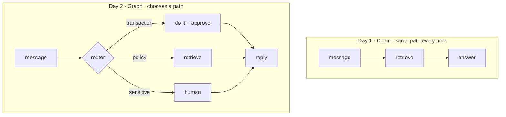

# Banking · Day 2 — LangGraph, a graph that decides

On Day 1 every message took the same path. But a bank assistant must **decide**:
a balance check, a withdrawal, a policy question and a fraud report are all
different — and some must **pause for a human**. A chain can't do that. A **graph** can.

Run the steps in order:

```bash
python banking/day_2/01_langgraph_basics.py    # the shape: state, nodes, edges
python banking/day_2/02_banking_assistant.py   # the assistant as a graph (type 'quit')
streamlit run banking/day_2/app.py             # a web chat with Approve / Decline buttons

# OPTIONAL stretch — a real local vector database (needs extra packages):
uv sync --extra vectordb
python banking/day_2/03_vector_db_optional.py  # BM25 -> embeddings, saved to disk
```

---

## Step 1 — The shape (`01_langgraph_basics.py`)
**State** (a shared dict), **nodes** (functions), **edges** (arrows). A tiny
two-node graph checks a withdrawal amount against the review limit — no LLM yet.



## Step 2 — The assistant as a graph (`02_banking_assistant.py`)
A **router** sends each message down the right path, and **withdrawals pause for a
human** before money moves:



Try these to see each path:

| Message | Path |
|---|---|
| `What's my balance?` | transaction → balance |
| `Withdraw 200000` | transaction → **human approval** → withdraw |
| `What is the daily withdrawal limit?` | policy → retrieve |
| `I lost my card` | sensitive → **human review** |

This one file reuses the **whole seminar**: routing, structured output (to read
the amount), transactions, RAG, and a human in the loop.

## Step 3 — A web page (`app.py`)
A **Streamlit** chat. Here the human-in-the-loop is a pair of **Approve / Decline
buttons** — a withdrawal waits until you click. The sidebar shows the live balance.

## Step 3b — OPTIONAL: a real vector database (`03_vector_db_optional.py`)
Swap BM25 for **Chroma** + embeddings. The database is saved to `banking/chroma_db/`,
and **only the retriever line changes** vs `day_1/03_rag_policies.py`.

```bash
uv sync --extra vectordb
python banking/day_2/03_vector_db_optional.py
```

---

## Chain vs Graph — the one idea to remember



Start simple with a chain; reach for a graph when you need decisions, actions,
and human review.
