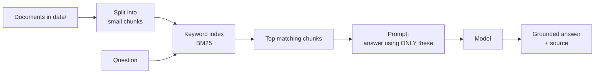
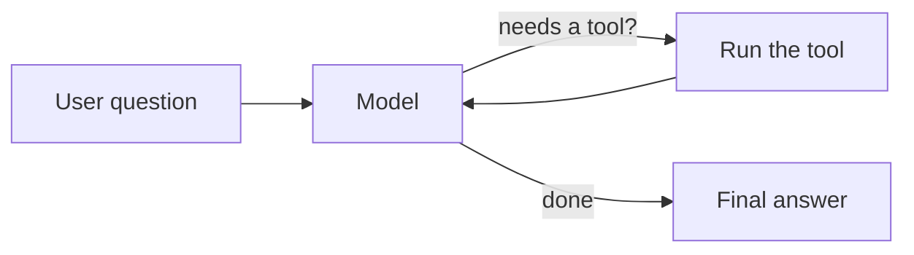
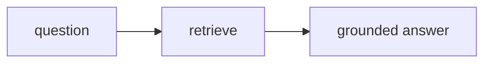

# Day 1 — LangChain Foundations

Today we learn the building blocks and finish with a working assistant that is
**one straight line**: question → retrieve → answer.

Run the steps **in order**. Each one is a small, self-contained file.

```bash
python day_1/01_chat.py      # talk to a model
python day_1/02_prompts.py   # prompt templates + typed output
python day_1/03_rag_hint.py  # answer from documents, with a source
python day_1/04_agent_tools.py          # let the model use tools
python day_1/05_assistant_langchain.py  # the capstone (type 'quit' to exit)
```

---

## Step 1 — Talk to a model (`01_chat.py`)
Send one message, get a reply. This is the whole foundation.

## Step 2 — Prompts & pipelines (`02_prompts.py`)
A **prompt template** = a fixed instruction + a blank to fill in.
A **chain** wires steps with the pipe `|`:

```
prompt  |  model  |  parse text
```

We also ask for **typed output** (named fields instead of a paragraph).

## Step 3 — Retrieval / RAG (`03_rag_hint.py`)
Instead of hoping the model "knows", we look the answer up in approved documents
first, then let it answer from what we found — and cite the source.



> We use **keyword search (BM25)** — no embeddings, nothing to download. It is the
> simplest way to see the RAG idea. Real systems often use embeddings for better matches.

## Step 4 — Tools & a simple agent (`04_agent_tools.py`)
A **tool** is just a function the model may call. An **agent** decides *when* to call it.



## Step 5 — The assistant, LangChain style (`05_assistant_langchain.py`)
Everything together as **one straight path** — every question is treated the same way:



That simplicity is the strength *and* the limit of a chain. On **Day 2** we give the
assistant the ability to choose different paths with **LangGraph**.
