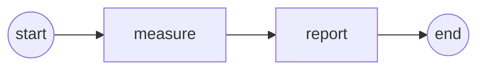
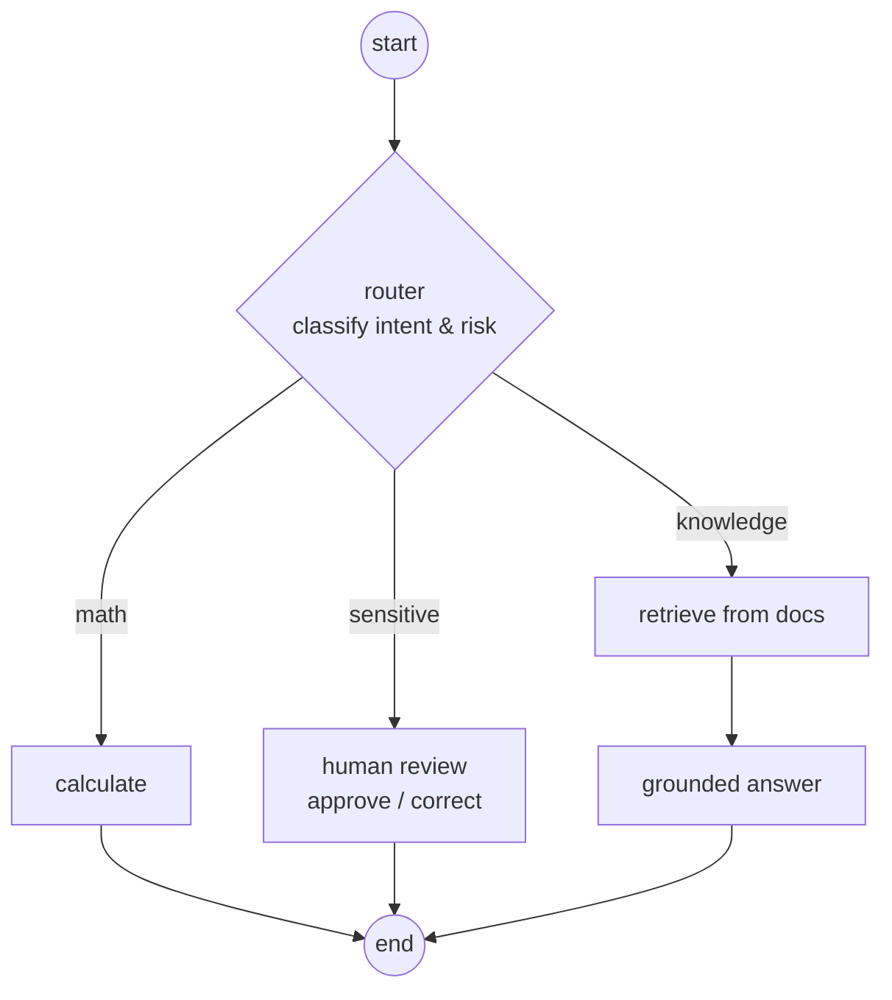
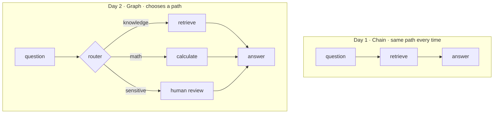

# Day 2 — LangGraph, Reliable Agents

On Day 1 the assistant was a straight line: every question went
`retrieve → answer`. That is fine until questions are **different** from each other.

- A math question does not need the handbook — it needs a calculator.
- A complaint about grades should **not** be answered automatically — a human should check.

A straight chain cannot make those choices. A **graph** can.

Run the steps in order:

```bash
python day_2/01_langgraph_basics.py       # the shape: state, nodes, edges
python day_2/02_knowledge_assistant.py    # the assistant as a graph (type 'quit')
streamlit run day_2/app.py                # a web chat page to demo
```

---

## Step 1 — The shape (`01_langgraph_basics.py`)
Three ideas:

- **State** — a shared dictionary passed from step to step.
- **Nodes** — functions that read the state and return updates.
- **Edges** — the arrows connecting the nodes.



## Step 2 — The assistant as a graph (`02_knowledge_assistant.py`)
The **same** assistant as Day 1, but a **router** now sends each question down the
right path, and sensitive questions **pause for a human**:



Try these three questions to see each path:

| Question | Path it takes |
|---|---|
| `What are the library hours?` | knowledge → retrieve |
| `What is 15 * 4?` | math → calculate |
| `I think my grade is wrong, what do I do?` | sensitive → **human review** |

## Step 3 — A web page (`app.py`)
A simple **Streamlit** chat page so teams can demo the assistant without building a
full frontend. It shows the answer **and the sources used**.

---

## Chain vs Graph — side by side



**That is the lesson of the seminar:** start simple with a chain, then reach for a
graph when you need decisions, tools, retries, and human review.
