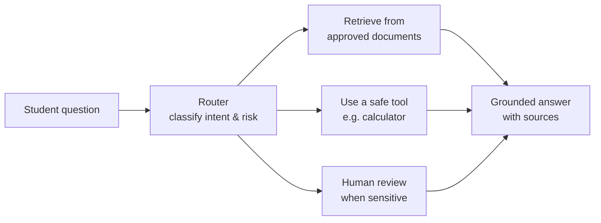

# University Knowledge Assistant — GenAI Seminar (Knowledge-Base Track)

The original seminar track: an **AI assistant that answers student questions using
only approved university documents**, and behaves responsibly.

> The sample documents are fictional — safe to share.

## What we're building

| Behaviour | Example |
|---|---|
| **Answers with a source** | *"The library is open Mon–Fri, 8am–10pm (source: iuiu_student_faq.md)"* |
| **Admits when it doesn't know** | *"I could not find this in the approved documents."* |
| **Uses a tool** | A math question goes to a calculator, not the handbook |
| **Asks a human** | A grade dispute or complaint **pauses for human review** |

We build it **twice**:

- **Day 1 — LangChain:** the assistant as a **straight line** — `retrieve → answer`.
- **Day 2 — LangGraph:** the same assistant rebuilt as a **graph** that routes, uses a
  tool, and pauses for a human.

### The demo (end of Day 2)

1. **Supported** — `What are the library hours?` → grounded answer **with source**
2. **Unsupported** — `Who won the 2010 World Cup?` → *"not in the approved documents"*
3. **Needs a human** — `I think my grade is wrong?` → **routed to human review**

---

## The big picture



---

## Setup (once)

Shares the repo's dependencies and `.env`:

```bash
uv sync                     # from the repo root
cp .env.example .env        # then paste your OpenRouter key
python knowledge_base/day_1/01_chat.py
```

Free key: <https://openrouter.ai/keys>. Default model is free
(`nvidia/nemotron-3.5-lightning:free`).

---

## What's inside

```
knowledge_base/
  day_1/   LangChain — a straight line
    01_chat.py                talk to a model
    02_prompts.py             prompt templates + typed output
    03_rag_hint.py            answer from documents, with sources
    04_agent_tools.py         tools: calculator / weather
    05_assistant_langchain.py the Day 1 capstone (one straight path)

  day_2/   LangGraph — a graph that decides
    01_langgraph_basics.py    state, nodes, edges (the shape)
    02_knowledge_assistant.py the SAME assistant, now routing + human review
    app.py                    a Streamlit chat page (switch BM25 / vector DB)
    03_vector_db_optional.py  OPTIONAL: a real local vector DB (Chroma)
    04_banking_agent.py       a bonus banking agent with human approval

  data/    sample student documents (fictional — safe to share)
```

See **[day_1/README.md](day_1/README.md)** and **[day_2/README.md](day_2/README.md)**
for the diagrams and the step-by-step walk-through.
